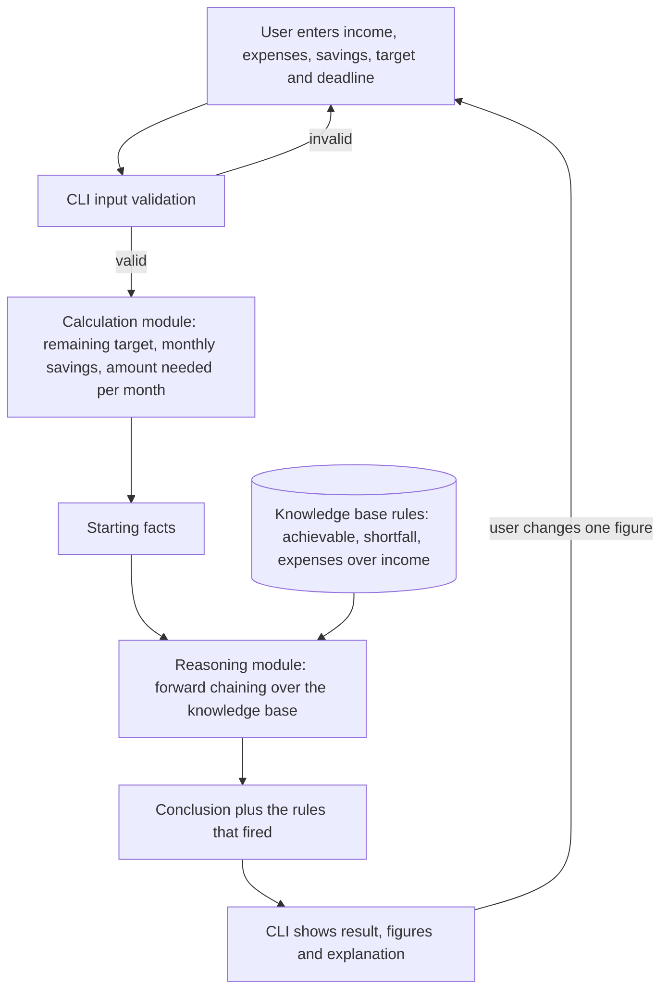

# Intelligent Financial Advice Assistant

## Team information

Group name: DTP

| Name | Student number | GitHub username |
| --- | --- | --- |
| Oluwadamise Adeniran | C24528163 | @Damise123 |
| Darling Mota | C24486262 | @darlingmota |
| Nischal Rana | C24392253 | @NischalRana29 |
| Prosper Umeh | C24365571 | @Pruber |
| Titas Utyra  | C24448002 | @Titas3012 |

## Problem description

Our group, DTP, plans to build an Intelligent Financial Advice Assistant that helps students work out whether they can reach a savings goal by a chosen date. For example, a student saving €600 for a laptop might have €100 left each month after expenses. If they want to buy the laptop in four months and are starting from zero, they would need to save €150 per month. Our assistant would explain the €50 monthly shortfall and show that saving €100 per month would take six months.

The user will enter their monthly take-home income, essential expenses, optional spending, current savings, target amount and deadline. The assistant will use these figures to assess the goal and explain which part of the budget led to its conclusion.

## Scope and feasibility

We will build a Python command-line assistant that assesses one savings goal at a time. For each assessment, we will assume the user’s monthly income and spending stay the same. The user can then change one figure and run the assessment again. For example, they could extend their deadline by two months to see whether they can reach the same goal without changing their spending.

We will use fictional budgets to test the assistant, including a case where the user has exactly enough to meet the deadline and one where their expenses exceed their income. Using manually entered figures keeps the project manageable and lets us focus on writing and testing the rules that explain each result.

There are a few limitations we know about. The assistant only looks at one goal at a time and doesn't account for interest, inflation or changes in income. It won't connect to real bank data, so the advice is only as good as the figures the user types in. It's also a student project, so it's meant to help people think through a goal, not replace real financial advice.

## Proposed AI approach

We will use a rule-based system with forward chaining. This approach suits our project because each recommendation can be traced back to the user’s budget and the rules that applied. The program will first calculate how much the user can save each month and how much they need to save to meet their deadline. These figures become the starting facts for the reasoning process.

For example, if a student can save €100 per month but needs €150, the first rule identifies a monthly shortfall of €50. A second rule uses that shortfall and the fact that the student can still save €100 each month to suggest a longer deadline. For a €600 goal starting from zero, the assistant would explain that six months is achievable at the current rate. If the student has nothing left after expenses, a different rule would explain why extending the deadline alone would not help.

## System design

The assistant will have three parts. First, a command-line interface will collect the user’s budget and savings goal. It will check that the amounts are valid and that the deadline is a positive number of months. Next, a calculation module will work out the remaining target, the monthly amount available to save and the amount needed each month. Finally, the reasoning module will apply the rules to those figures and record which rules led to its conclusion. The interface will display the result alongside the relevant figures so the user can see how the assistant reached its answer.

## Planned contributions

| Team member | Planned responsibility |
| --- | --- |
| Titas Utyra | Build the command-line interface, validate the user’s inputs and connect the interface to the rest of the program. |
| Oluwadamise Adeniran | Implement the calculations for the remaining savings target, monthly balance and amount needed each month. |
| Darling Mota | Write the knowledge base, including rules for an achievable goal, a monthly shortfall and expenses exceeding income. |
| Nischal Rana | Implement forward chaining and record which rules led to each conclusion so the assistant can explain its answer. |
| Prosper Umeh | Create test budgets with expected results, test the complete program and prepare examples for the live demo. |

## Acknowledgements

We used ChatGPT to brainstorm the project scope, help draft the proposal and format the Markdown tables.
